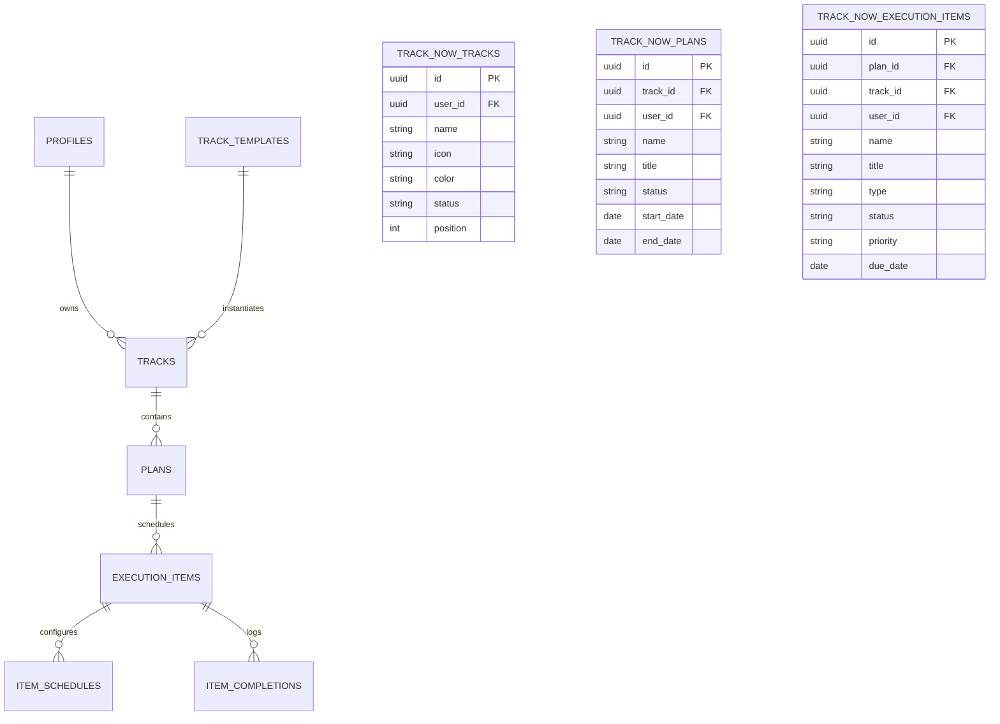

# Track.now — Architecture & System Design

This document details the architectural principles, module boundaries, data flows, and design decisions governing **Track.now**.

---

## 1. Architectural Philosophy: The Modular Monolith

Track.now intentionally avoids microservice fragmentation, multi-repo overhead, and complex intermediary proxy servers. It is structured as a **modular monolithic client application backed directly by a serverless relational data engine (Supabase/PostgreSQL)**.

### Core Architectural Decisions
1. **Direct-to-Postgres Security Model:** Authentication, access control, and tenant isolation are enforced at the database layer via **PostgreSQL Row Level Security (RLS)**. No Node.js/Express middleware is required to authorize reads or writes.
2. **Deterministic Domain Layer:** Business calculations (progress rollups, completion metrics, scheduling classifications) are implemented as pure, side-effect-free TypeScript functions located in `src/domain/`.
3. **Repository/Service Separation:** Components never construct ad-hoc Supabase queries. All database operations are channeled through strongly typed services in `src/services/`.
4. **Tokenized Design System:** All UI components rely exclusively on semantic design tokens (`src/styles/tokens.css`), eliminating arbitrary inline styling and making dark/light theme switching zero-friction.

---

## 2. Layered Architecture Diagram

```
┌─────────────────────────────────────────────────────────────────┐
│                          PRESENTATION LAYER                     │
│  Pages (`src/pages/*`)  │  Components (`src/components/*`)      │
└────────────────┬────────────────────────────────┬───────────────┘
                 │                                │
                 ▼                                ▼
┌────────────────────────────────┐   ┌────────────────────────────┐
│      APPLICATION & HOOKS       │   │       DOMAIN LAYER         │
│  - AuthProvider & useAuth      │   │  - progress.ts             │
│  - useTheme & UI Hooks         │   │  - dates.ts                │
│  - Page Route Guards           │   │  - types/domain.ts         │
└────────────────┬───────────────┘   └────────────▲───────────────┘
                 │                                │ (Pure Types & Math)
                 ▼                                │
┌─────────────────────────────────────────────────┴───────────────┐
│                     SERVICE / REPOSITORY LAYER                  │
│  - tracksService.ts   │  - plansService.ts                      │
│  - executionService.ts│  - authService.ts                       │
└────────────────────────────────┬────────────────────────────────┘
                                 │
                                 ▼
┌─────────────────────────────────────────────────────────────────┐
│                     INFRASTRUCTURE / CLIENT                     │
│  - lib/supabase/client.ts (Supabase JS SDK)                     │
└────────────────────────────────┬────────────────────────────────┘
                                 │ HTTPS / WebSockets
                                 ▼
┌─────────────────────────────────────────────────────────────────┐
│                      SUPABASE BACKEND (PostgreSQL)              │
│  - Auth Engine (GoTrue)  │  - Row Level Security (RLS)          │
│  - Schema Tables         │  - Realtime Change Notifications     │
└─────────────────────────────────────────────────────────────────┘
```

---

## 3. Layer Responsibilities & Strict Boundaries

### Layer 1: Presentation (`src/pages`, `src/components`)
- **Responsibilities:**
  - Renders UI state, handles user interactions, manages local form input states.
  - Consumes services and domain functions; handles loading and error states with reusable primitives (`<LoadingState />`, `<ErrorState />`, `<EmptyState />`).
- **Strict Rule:** Presentation components **MUST NOT** import `supabase` directly. They must always use the service methods in `src/services/` or hooks in `src/features/`.

### Layer 2: Domain Layer (`src/domain`)
- **Responsibilities:**
  - Pure algorithmic calculations: progress percentages, plan rollups, track status aggregations, due date classification (overdue, today, upcoming).
  - Contains zero I/O, zero network calls, zero DOM mutations, and zero Supabase dependencies.
- **Strict Rule:** Domain functions must remain 100% deterministic and unit-testable without mocking network or browser APIs.

### Layer 3: Service / Repository Layer (`src/services`)
- **Responsibilities:**
  - Encapsulates database queries, mutations, sanitization, and error translations.
  - Transforms raw database rows into domain TypeScript interfaces (`src/types/domain.ts`).
  - Implements atomic operations (e.g. creating an item completion record and updating the item status in a single transaction or paired call).

### Layer 4: Infrastructure (`src/lib/supabase`)
- **Responsibilities:**
  - Initializes the single `@supabase/supabase-js` client instance.
  - Validates environment variables (`isSupabaseConfigured()`) and guards against runtime crashes when API keys have not been configured yet.

---

## 4. Domain Data Model & Invariants



### Invariants & Business Rules
1. **Duplicate Tracks Allowed:**
   If a user creates a track with a name that already exists (e.g., a second "Fitness" track for a distinct athletic endeavor), the system **does not block them**. A confirmation dialog politely prompts them:
   > *"You already have a [Name] Track. Would you like to use your existing Track or create another one?"*
   Choosing to continue creates a distinct new track with its own UUID.

2. **Progress Calculations Never Faked:**
   Track and Plan progress is calculated purely:
   $$\text{Progress \%} = \text{round}\left(\frac{\sum \text{items with status 'done'}}{\sum \text{active non-archived items}} \times 100\right)$$
   - If there are 0 items in an active plan, progress is strictly $0\%$.
   - Archived items and archived plans are excluded from active track progress rollups.

3. **Status Transitions:**
   - Tasks / Habits / Checklists toggle between `'todo'` and `'done'`.
   - Projects and Milestones can transition through `'todo' -> 'in_progress' -> 'done'`.
   - Archival is non-destructive: archiving a Track or Plan sets `status = 'archived'`. All children remain intact and can be restored at any time.

---

## 5. Security & Multi-Tenancy Architecture

### Row Level Security (RLS)
Track.now relies on PostgreSQL RLS policies where every table with user data has:
```sql
ALTER TABLE <table> ENABLE ROW LEVEL SECURITY;

CREATE POLICY "Users can only manage their own data"
  ON <table>
  FOR ALL
  USING (auth.uid() = user_id)
  WITH CHECK (auth.uid() = user_id);
```
Even if a compromised or malicious client crafts an arbitrary Supabase API query with another user's UUID, RLS returns an empty set or an error for table access.

**Exception — SECURITY DEFINER functions bypass RLS.** `public.track_now_increment_item_count` (added in
`20261008000000`) trusted a client-supplied user id. The client no longer sends one, and
`20261012000000_secure_increment_item_count_rpc.sql` (prepared, **not applied**) rebuilds the function
around `auth.uid()` with a pinned `search_path` and least-privilege grants; `20261013000000` adds
`count_date` so the server decides a habit's daily counter restart. Both were verified on a disposable local
PostgreSQL cluster (`node scripts/verify_sql_local.cjs`), not on the live project. See `SECURITY_AUDIT.md`.

**Habit counters.** A habit's `current_count` belongs to one local day (`count_date`). Shared rules live in
`domain/habitCounter.ts` (effective count, stale-day detection) and are mirrored by the RPC; edits only touch
count/status/history when count, target or type change.

### Authentication Flow
1. User submits email/password to `supabase.auth.signUp()` or `supabase.auth.signInWithPassword()`. Forms block duplicate submissions and map rate-limit (HTTP 429) responses to clear messages.
2. Supabase issues JWT access and refresh tokens stored in local browser storage via the Supabase client. The client uses the **PKCE** flow, so emailed links carry a one-time `?code=` usable only by the browser that requested them.
3. The database trigger `on_auth_user_created_track_now` automatically inserts a corresponding row in `public.track_now_profiles`.
4. `AuthProvider` listens to `supabase.auth.onAuthStateChange` to synchronize session state into React context without page reload.
5. Password recovery: the email links to `/reset-password` (origin from `VITE_APP_URL` when set). The `PASSWORD_RECOVERY` event is recorded in a tab-scoped, one-hour marker; only such a session sees the new-password form, and route guards send it there from any page.
6. Sign-out revokes the session server-side when possible, otherwise signs out locally and says so. Any sign-out or account switch wipes the previous user's reminders, widget snapshot, toasts and visible notifications.
7. Protected routes remember the requested page; after login the user returns there (validated same-origin paths, re-checked after normalisation). Not after a manual sign-out. An unreachable server shows an offline retry screen instead of the login form.
8. Routing: React Router 7 in library mode (`<BrowserRouter>`), no data router or SSR.

---

## 6. PWA, Reminders & Device-Local Data

- **Service worker (`public/sw.js`, v3):** network-first for navigations with an offline fallback to the cached
  shell; the shell's assets are precached at install; cache-first for content-hashed `/assets/*` but never for
  non-OK or HTML responses; assets of old deploys are pruned. Only same-origin GET requests are handled (Supabase
  responses never are). Notification clicks accept same-origin paths only and route in-app via `postMessage`.
- **Theme bootstrap:** `public/theme-init.js` (external so the CSP `script-src 'self'` allows it).
- **Reminders:** `services/reminderService.ts` stores reminders per user in localStorage;
  `services/webNotificationEngine.ts` checks every 20 s and on focus/visibility while the app is open.
  In-app alerts show in the visible tab; browser notifications need permission and the Settings toggle. One
  delivery across tabs (Web Locks / localStorage claim). Up to 3 reminders are shown per catch-up, the rest (and
  anything more than a day late) as one summary. Habit reminders repeat on scheduled days. Before the first
  sweep and every 10 minutes the engine reconciles reminders with the server (items deleted, archived or done
  elsewhere); a failed load never cancels anything.
  **Nothing fires while the browser is closed** — there is no Web Push sender.
- **Daily briefing / overdue alert:** once a day at the chosen time, while the app is open.
- **Device-local data:** reminders (`tracknow_reminders_<uid>`), notification preferences
  (`tracknow_notification_prefs_<uid>`), review notes (`tracknow_reviews_<uid>`), widget snapshot
  (`tracknow_widget_data_<uid>`). None of it syncs across devices.
- **Native:** `android/` and `ios/` contain widget sources only; there is no Capacitor app or native build.
- **Responsive Layout:** `AppShell` shows a persistent sidebar at ≥ 900 px and a top bar, drawer, and bottom
  navigation below that.

## 7. Analytics & Reviews

- `domain/analytics.ts` and `domain/reviews.ts` are pure functions over Tracks, Plans, items, and the
  completion log (`services/historyService.ts`). Empty data produces empty states, never sample numbers.
- Progress everywhere (Plan, Track, Dashboard, Analytics) uses `domain/progress.ts`; habits count as
  done only when completed today, and habits not scheduled today are left out of today's total.
  History and item queries are paged (`services/helpers.ts#fetchAllPages`), so nothing is cut at 1000 rows.
- Review notes are saved per user on the device (`services/reviewNotesStorage.ts`) because no reviews
  table has been approved.
